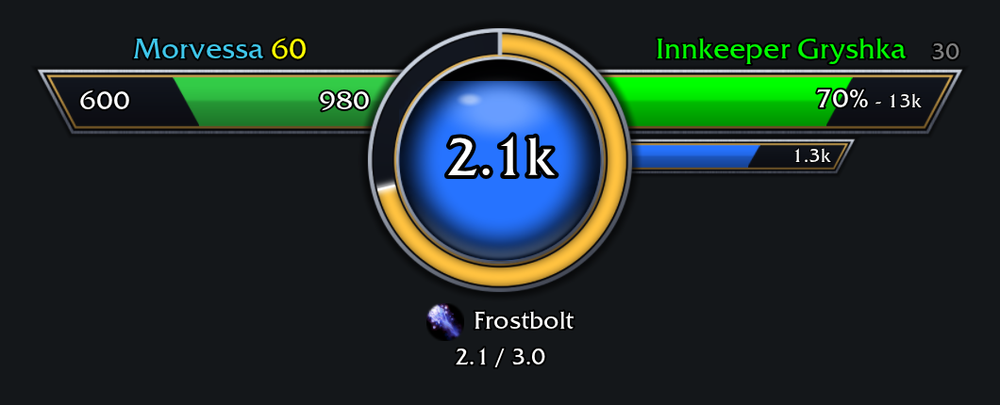

# DibsUI

A World of Warcraft Forever addon that replaces the player, pet, target and target of target frames with a single winged layout: your health and your pet on the left, your target and its target on the right, and an orb in the middle for your power and casts.

*Captured in the [UIForever](https://uiforever.com/) simulator at 2x scale and full combat opacity, with health, power, pet, target and cast values set by hand to show every field.*

## Features

**Player bar (left)**
- Health fills from the orb outwards, with current health on the right
- Health deficit on the left, hidden at full health
- Class-colored name and yellow level above the bar

**Pet bar (far left)**
- Sits against the end of the player bar, and only shows when you have a pet
- Name and yellow level above the bar
- Current and maximum health in the center, while your mouse is over the bar
- Happiness face at the bottom left for hunter pets, with Blizzard's tooltip

**Target bars (right)**
- Slide out from under the orb when you select a target, and back in when you clear it
- Health shown as `70% - 13k`, plus a smaller power bar with its amount
- Health bars and names are class colored for friendly players, and health bars are reaction colored for everyone else
- Friendly NPC names use reaction color, and other names are white
- Level at the top right, colored grey, green, yellow, orange or red by difficulty

**Target of target (far right)**
- Sits against the end of the target's health bar and slides out with it
- Name and difficulty-colored level above the bar, with the bar and name colored like the target's
- Can be turned off in the settings

**Orb (center)**
- Fills from the bottom with your power, colored by power type, with the amount in the middle
- Numbers are shortened: `999`, `1.2k`, `12k`, `1.2m`

**Combo points**
- A five-segment ring on the inner edge of the orb, filling clockwise from 12 o'clock
- The first two points are yellow, the next two orange, and the last red
- Shows for rogues, and for druids in cat form, with the points on your current target

**Mana spark**
- After a successful spell that costs mana, a gold spark circles the orb's inner edge once over five seconds, showing the five second rule
- Casting again restarts it, and potions, food, wands and free spells don't start it

**Cast ring**
- Fills clockwise around the orb while casting, and drains clockwise while channeling
- Shows a round spell icon, the spell name and `current / total` time below the orb
- Runs in grey for your main hand swing timer when you aren't casting

**Opacity**

| State | Opacity |
|---|---|
| In combat | 100% |
| Out of combat, targeting an attackable unit | 60% |
| Out of combat, with health below full, or power away from its idle level | 60% |
| Otherwise, out of combat | 30% |

Rage idles at 0, and other power types idle at full. Casts always show at 100%, whatever the rest of the frame is doing.

**Clicks**
- Left-click a bar to target that unit, and right-click for its menu

**Minimap button**
- Click it to open or close the settings, and drag it to move it around the minimap's edge
- Can be hidden in the settings

## Installation

Copy the `DibsUI` folder into your game's `_forever_/Interface/AddOns/` folder, then restart the game or type `/reload`.

The other files in this repository aren't needed in-game.

## Settings

Type `/dui` or `/dibsui`, or click the minimap button, to open the settings window. It's built from Blizzard's newer panels, switches, sliders and dropdowns.

**Show minimap button**, at the top of the window, turns the minimap button on or off.

The options are on the **Look and feel** tab.

**Frames**

| Setting | What it does |
|---|---|
| Lock position | Switch it off to show a drag handle and move the frames. Bars don't respond to clicks until you lock it again. |
| Show target of target | Turns the target of target bar on or off. |
| Scale | Scales everything from 0.50 to 2.00. Use the slider or its arrows, or type an exact value and press Enter. |
| Width | Sets the length of the player and target bars from 0.50 to 2.00. Use the slider or its arrows, or type an exact value and press Enter. |
| Pet and target of target width | Sets the length of both of those bars from 0.50 to 2.00. Use the slider or its arrows, or type an exact value and press Enter. |

**Position**

| Setting | What it does |
|---|---|
| Center horizontally | Centers the orb on the screen, keeping its height. The pet bar doesn't change where the center is. |
| Up, Down, Left, Right | Moves the frames one screen pixel. These and Center work whether or not the position is locked. |

**Text**

Pick a text field, such as the target's name or the orb's power, then change its look:

| Setting | What it does |
|---|---|
| Font | The game's fonts, plus any fonts from addons that use LibSharedMedia. Each one is shown in its own typeface. |
| Size | From 6 to 40. |
| Custom color | Switch it on and click the swatch to pick a color. Switched off, the field keeps its usual color, such as a class or difficulty color. In name and level fields, the level stays yellow. |
| Reset this text | Puts the field's font, size and color back to their defaults. |
| Use font for all text | Gives every field the font of the one you've picked, leaving sizes and colors alone. |

Settings are saved per account. Frame and position settings can't be changed during combat, but text and minimap settings can.

## Status

Early development, for interface version 16001.

So far DibsUI has been tested in the UIForever simulator and with offline checks, not in the live game. Behavior that depends on the real client, such as secret health and power values in combat, real swing timer events, a real pet, real combo points, real spell costs and how the settings window looks in the live game, still needs checking in-game.

## Known limitations

- Hiding Blizzard's target frame also hides your target's buffs and debuffs
- Totem and class resource bars still sit where Blizzard's player frame was
- In a vehicle, the bars keep showing your character
- Only the main frames are kept on screen when dragging, so the pet and target of target bars can go past the screen's edges
- The target of target bar still shows when you target yourself
- The mana spark won't start for a spell whose cost is a secret value, and may start for a free cast from a proc like Clearcasting
- Names are cut short to fit their bar, so a larger font size shows less of a long name
- Fills start outside the orb's ring, so a nearly empty health bar looks slightly fuller than it is
- If health and power are both secret values out of combat, only health can affect opacity

## License

[MIT](LICENSE)
